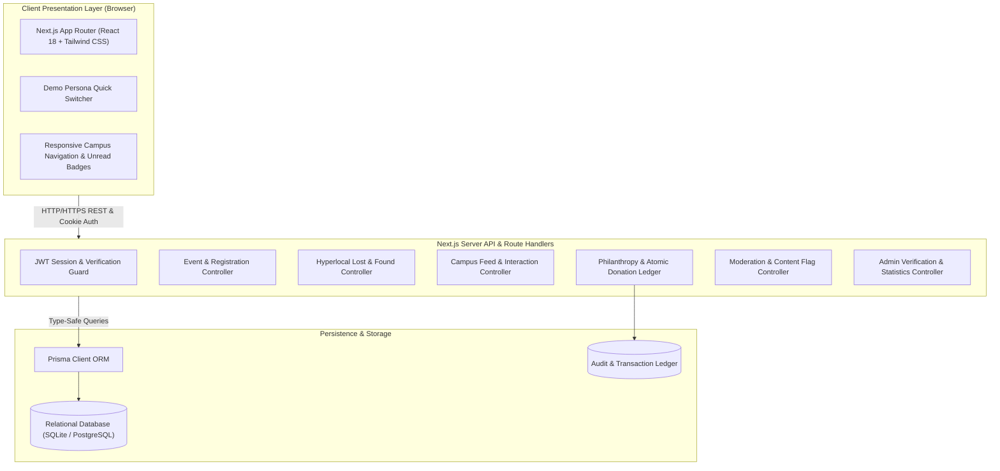
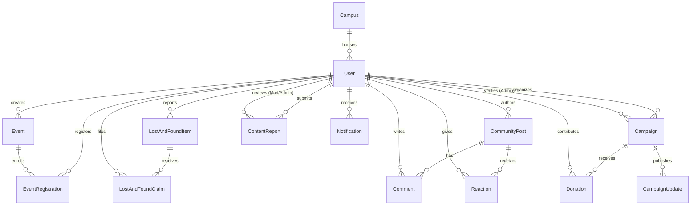
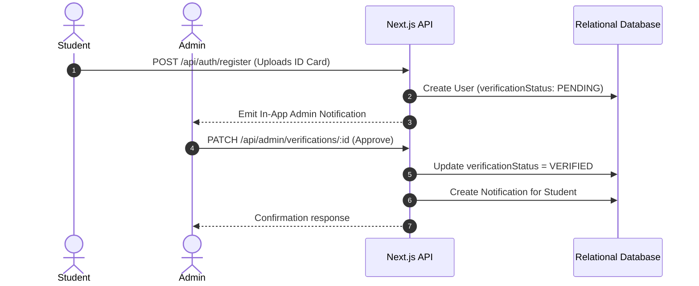
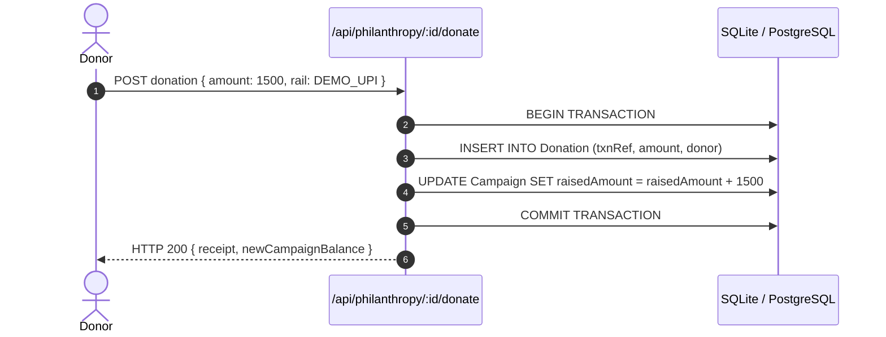
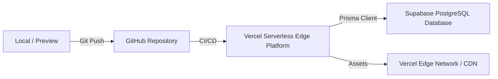

# CampusConnect System Architecture
## National Institute of Technology Andhra Pradesh

### 1. High-Level Architecture Overview

CampusConnect is structured as a full-stack Next.js application following modern software engineering principles: strict separation of concerns, atomic server transactions, role-based authorization, and persistent relational data modeling.

---

### 2. Frontend & Backend Responsibilities

#### Frontend (Presentation)
- **Framework**: Next.js 14 App Router, React 18, TypeScript, Tailwind CSS, Lucide React icons.
- **State & UI Feedback**: Live capacity progress bars, immediate visual confirmation badges, optimistic toggling for likes and reactions, modal dialogs for content reporting and claims.
- **Evaluator Utilities**: Integrated `DemoSwitcherModal` that allows testers to change personas (Student, Moderator, Admin, Unverified) with 1 click without losing application context.

#### Backend (Business Logic & Authorization)
- **Authentication**: JWT session tokens signed with `JWT_SECRET`, transmitted via HTTP-only, SameSite cookies (`cc_session`) to mitigate XSS and CSRF.
- **Verification Guard**: Restricts sensitive actions (starting public philanthropy drives, moderation queues) to authenticated and authorized personas.
- **Atomic Operations**: Financial donations utilize `prisma.$transaction` to guarantee that updating `Campaign.raisedAmount` and creating the `Donation` audit record occur as a single indivisible operation.
- **Capacity Enforcement**: Queries current confirmed attendees against event capacity within server route handlers to prevent race conditions and overbooking.

---

### 3. Database Entity Relationship Model (ERD)

---

### 4. Core Security & Business Workflows

#### A. Campus Verification Workflow
1. Student registers using `@nitandhra.ac.in` email -> Automatically designated as `VERIFIED`.
2. Student registers using other email domains or uploads ID card -> Designated as `PENDING`.
3. Administrator reviews the uploaded ID in `/admin` console -> Approves or Rejects identity with automated notification.

#### B. Event Registration & Capacity Enforcement
1. Student requests registration for an upcoming event.
2. Server queries current `CONFIRMED` registrations count.
3. Server checks unique composite constraint `(eventId, userId)`: if already registered, returns HTTP 409 Conflict.
4. Server verifies `count < capacity`: if full, returns HTTP 400 Bad Request.
5. If valid, upserts registration and increments attendee counter.

#### C. Verified Crowdfunding & Atomic Donation Ledger
1. Student creates campaign with story and fund usage plan -> Enters `PENDING_REVIEW`.
2. Administrator reviews campaign in `/admin` -> Approves and grants `VERIFIED` status.
3. Public donors initiate test donation (UPI, Card, NetBanking).
4. Server generates audit transaction reference (`NITAP-SIM-XXXXXX`).
5. Server executes atomic `$transaction`:
   - Inserts `Donation` record.
   - Atomically increments `Campaign.raisedAmount`.
6. Immediate digital receipt emitted; campaign balance instantly updated without full page refresh.

---

### 5. Production Deployment Architecture

- **Database Migration to Production**: Replace `provider = "sqlite"` with `provider = "postgresql"` in `prisma/schema.prisma` and provide `DATABASE_URL` for hosted PostgreSQL (Supabase / Neon / AWS RDS).
